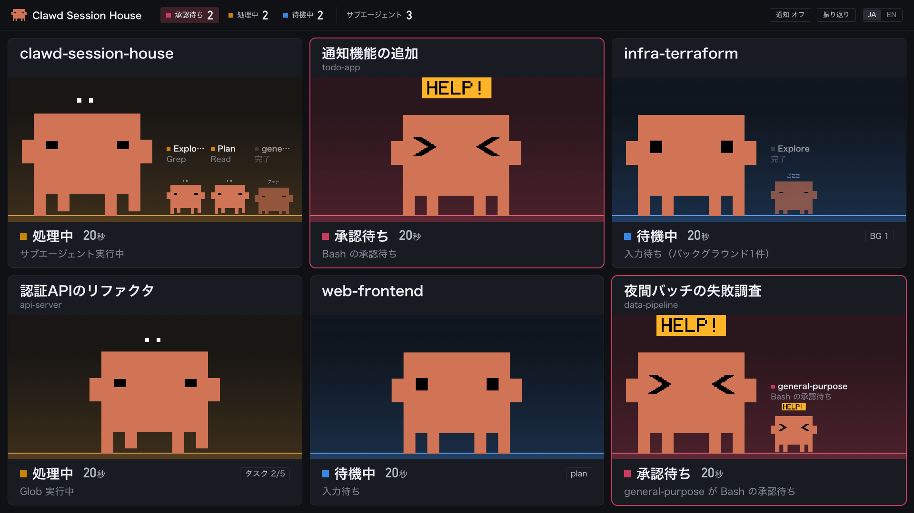
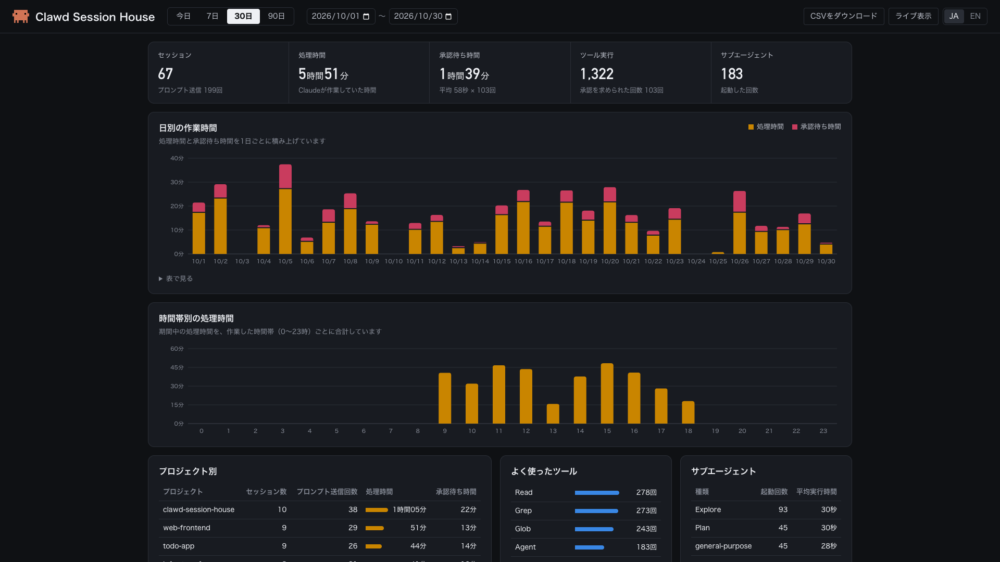

# clawd-session-house

複数のClaude Codeセッションの状態を、ブラウザでまとめて見られるダッシュボードです。

## できること

### ライブ表示



セッションごとに1つのタイルを表示します。タイルはClawdの部屋で、Clawdの動きと部屋の明かりの色で状態が分かります。

- 明かりの色は、待機中は青、処理中は琥珀、承認待ちは赤です。
- 経過時間、実行中のツール、サブエージェント、タスクリストの進み具合、バックグラウンド作業の件数を表示します。
- 承認待ちになったときと、1分以上の処理が終わったときに、デスクトップ通知を出せます。ヘッダーの「通知 オフ」を押して、通知を許可してください。
- タイルはドラッグで並べ替えられます。同じフォルダで開いたセッションは、線の枠で囲んでまとめます。
- `F`キーか、ヘッダーのダブルクリックで全画面表示に切り替わります。

### 振り返り



ライブ表示のヘッダーの「振り返り」で開きます。

- 処理時間と承認待ち時間を、日別・時間帯別・プロジェクト別に集計します。よく使ったツールと、サブエージェントの種類別の回数も出します。
- セッションを選ぶと、待機中・処理中・承認待ちの移り変わりをタイムラインで見られます。
- 期間は「今日・7日・30日・90日」のほか、開始日と終了日でも選べます。
- 選んだ期間のセッション一覧を、CSVでダウンロードできます。

### 共通

- ヘッダー右端の「JA / EN」で、日本語と英語を切り替えられます。
- 記録は手元のSQLiteにだけ保存します。プロンプトの本文やツールの入力内容は、保存も表示もしません。

## 必要なもの

- OS
  - macOS
  - Linux(Ubuntu)
  - Windows(WSL2)
- ソフトウェア
  - Claude Code
  - Python 3.9以上
  - curl
  - ブラウザ(Chromeなど)

## インストール

### プラグインで入れる

おすすめの入れ方です。Claude Codeの中で次のコマンドを実行し、新しいセッションを始めます。サーバーは、セッションが始まったときに自動で起動します。

```text
/plugin install clawd-session-house --marketplace Lamaglama39/clawd-session-house
```

Claude Code 2.1.275より前では、マーケットプレイスを追加してからインストールします。

```text
/plugin marketplace add Lamaglama39/clawd-session-house
/plugin install clawd-session-house@lamaglama39
```

### 手動で入れる

リポジトリを手元に置き、`install-hooks.py`で`~/.claude/settings.json`にフックを登録します。書き込む前にバックアップを作り、ほかの設定やフックは変えません。

```bash
git clone https://github.com/Lamaglama39/clawd-session-house.git
cd clawd-session-house
python3 plugin/scripts/install-hooks.py --dry-run   # 追加内容を表示するだけ
python3 plugin/scripts/install-hooks.py
```

> [!NOTE]
> 両方の方法で入れると、イベントが2回届いて記録が二重になります。手動からプラグインに切り替えるときは、先に`python3 plugin/scripts/install-hooks.py --uninstall`を実行してください。

手元のリポジトリをプラグインとして読み込み、変更を試す方法は、[開発](docs/development.md#プラグインとして試す)を参照してください。

## 使い方

ブラウザで`http://127.0.0.1:8765/`を開きます。サーバーが動いていなければ、Claude Codeのセッションを始めてください。

プラグインで入れた場合は、Claude Codeの中で次のスキルを使えます。`open`は「セッションハウスを開いて」と頼んでも使われます。

| スキル                         | すること                                                       |
| ------------------------------ | -------------------------------------------------------------- |
| `/clawd-session-house:open`    | サーバーが止まっていれば起動し、ライブ表示をブラウザで開く     |
| `/clawd-session-house:restart` | サーバーを起動し直す。更新したあとや、表示がおかしいときに使う |
| `/clawd-session-house:stop`    | サーバーを止める。次のセッションが始まると、また自動で起動する |

ポートの変更や記録の保存先などは、[設定と運用](docs/configuration.md)を参照してください。

## 更新

プラグインで入れた場合は、次のコマンドで更新し、新しいセッションを始めます。新しいセッションが始まると、サーバーも新しい版で起動し直します。自動更新は既定でオフです。`/plugin`の「Marketplaces」で有効にできます。

```bash
claude plugin marketplace update lamaglama39
claude plugin update clawd-session-house@lamaglama39
```

手動で入れた場合は、取り込んでからフックを登録し直し、サーバーを再起動します。フックを登録し直すのは、新しい版でフックが増えていることがあるためです。

```bash
git pull
python3 plugin/scripts/install-hooks.py
./plugin/scripts/stop-server.sh && ./plugin/scripts/start-server.sh
```

> [!NOTE]
> プラグインのファイルは`plugin/`の下に移しました。以前の`scripts/`などで実行していた場合は、上のように`plugin/`を付けて実行してください。`git pull`してからフックを登録し直すまでの間は、Claude Codeにフックのエラーが出ることがあります。振り返りの記録の`data/`は、これまでどおりリポジトリの直下に置きます。

どちらの場合も、開いているダッシュボードは再読み込みすると新しい画面になります。

## アンインストール

プラグインで入れた場合は、`/clawd-session-house:stop`でサーバーを止めてからアンインストールします。振り返りの記録も消えます。記録を残すときは、`--keep-data`を付けます。

```bash
claude plugin uninstall clawd-session-house@lamaglama39
claude plugin marketplace remove lamaglama39   # マーケットプレイスの登録も外す場合
```

手動で入れた場合は、次のとおりです。

```bash
./plugin/scripts/stop-server.sh
python3 plugin/scripts/install-hooks.py --uninstall
rm -rf data run   # 振り返りの記録とログも消す場合
```

## 詳しい情報

- [設定と運用](docs/configuration.md): ポートの変更、サーバーの起動と停止、記録の保存先と保持期間、他の端末から見る方法
- [困ったとき](docs/troubleshooting.md): タイルが出ない、通知が出ない、状態が戻らないときの確認方法
- [仕様](docs/specification.md): 仕組み、フックと状態の対応、画面の表示内容、通知の条件、記録する内容、API
- [開発](docs/development.md): テスト、デモ、ファイル構成

## ライセンスと注意事項

ソースコードは[MITライセンス](LICENSE)で公開しています。

Clawdのキャラクターは、MITライセンスの対象外です。ClawdはAnthropic PBCの著作物で、著作権表示は「© Anthropic PBC」です。
Clawdは、次のファイルに含まれます。

- `plugin/web/clawd.js`: Clawdのドット絵を描くコード
- `plugin/web/favicon.svg`: ファビコン
- `docs/images/`: スクリーンショット

これらはこのプラグインで使うためだけに置いており、このリポジトリのライセンスはClawdを使う権利を与えません。フォークや再配布をするときは、Clawdの扱いをご自身の責任で判断してください。詳しくは[NOTICE](NOTICE)を参照してください。

このプロジェクトは非公式のもので、Anthropicとは提携しておらず、Anthropicの承認や支援も受けていません。
「Claude」「Claude Code」「Clawd」「Anthropic」はAnthropic PBCの商標で、ここでは説明と識別のためだけに使っています。
