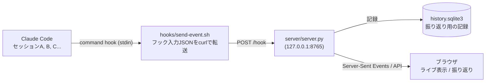

# 仕様

## 仕組み

- フックの入力JSONには`session_id`と`cwd`が入っているので、それを使ってセッションごとに状態を管理します。
- `send-event.sh`は何があっても何も出力せず`exit 0`で終わります。サーバーが止まっていても、Claude Codeの動作や権限判断には影響しません。
- `SessionStart`のフックは`--autostart`付きで呼ばれ、サーバーが動いていなければ起動します。サーバーは複数のセッションで共有するので、`SessionEnd`では止めません。
- サーバーはPythonの標準ライブラリだけで動きます。
- サーバーは`127.0.0.1`で待ち受けます。`Host`ヘッダーを検査してDNSリバインディング経由の操作を防ぎ、`POST /hook`は`Content-Type: application/json`だけを受け付けます。ほかのサイトの枠には埋め込ませません。

## フックと状態の対応

| フックイベント                                                                        | 状態              | 明かり    | 表示                                                                        |
| ------------------------------------------------------------------------------------- | ----------------- | --------- | --------------------------------------------------------------------------- |
| `SessionStart`                                                                        | 起動              | 青        | 起床してひと跳ねし、1.6秒後に待機中になる                                   |
| `UserPromptSubmit` / `PreToolUse` / `PostToolUse` / `PostToolUseFailure`              | 処理中            | 琥珀      | 歩きながら"..."を出し、実行中のツール名を表示                               |
| `PermissionRequest`                                                                   | 承認待ち          | 赤        | 困り顔で"HELP!"を出す。明かりが明滅し、承認待ちのツール名を表示             |
| `Notification`の`permission_prompt` / `elicitation_dialog` / `elicitation_url_dialog` | 承認待ち          | 赤        | 同上                                                                        |
| `Elicitation` / `ElicitationResult`                                                   | 承認待ち / 処理中 | 赤 / 琥珀 | MCPサーバーからの入力要求と、その回答後                                     |
| `PermissionDenied`                                                                    | 処理中            | 琥珀      | auto modeの自動拒否。Claudeは作業を続ける                                   |
| `Stop` / `StopFailure`                                                                | 待機中            | 青        | 呼吸とまばたき。`StopFailure`では「APIエラーで停止」と表示                  |
| `Notification`の`idle_prompt`                                                         | 待機中            | 青        | 応答後約60秒入力が無いときの補助                                            |
| `SessionEnd`                                                                          | 終了              | 消灯      | おやすみ演出の後、60秒でタイルが消える。右上の「×」ですぐに消すこともできる |
| `SubagentStart` / `SubagentStop`                                                      | 変えない          | 変えない  | サブエージェントの列に追加する。完了したら眠るClawdを20秒表示してから消す   |
| `TaskCreated` / `TaskCompleted`                                                       | 変えない          | 変えない  | タスクの進み具合を更新                                                      |

`agent_id`が付いた、サブエージェントの中で起きたツールのイベントは、親セッションの状態を変えずにサブエージェント側に表示します。
親が入力待ちのままバックグラウンドのサブエージェントが動いている場合も、親は「待機中」のままです。
ただし、サブエージェントが`PermissionRequest`で承認を求めたときは、ユーザーの操作が必要なので親も「承認待ち」にし、承認後に元の状態へ戻します。

承認ダイアログで手動で拒否した場合と、Escで中断した場合は、フックが発火しません。次のプロンプトを送るか、`idle_prompt`の通知が届くと正しい状態に戻ります。

## ライブ表示

ブラウザのウィンドウの大きさに合わせて、タイルが最も大きくなる列数を選びます。承認待ちのセッションは部屋の明かりが明滅し、タイルの外周も赤くなります。

- 並び順: 最初は開始時刻順です。タイルをドラッグして別のタイルの上に落とすと、そのタイルの場所に移ります。並べ替えた順はブラウザの`localStorage`に保存し、再読み込みしても保ちます。並べ替えたあとに始まったセッションは後ろに付きます。
- 同じフォルダで開いたセッションが2件以上あるときは、線の枠で囲んでまとめます。フォルダは`cwd`で見分けます。
  - まとまりは、その中で先頭のセッションの位置に置きます。区画は長方形で、1行に入りきらないときは折り返し、端数の分は枠の中が空きます。
  - タイルはまとまりから出られません。別のまとまりのタイルに落とすと、まとまりごと動きます。ドラッグ中は、動く先のタイルが明るくなります。まとまりごと動くときは、枠が明るくなります。
  - まとまりがあるときは、枠を引くためにタイルの間隔を少し広げます。
- 見出し: セッション名があればセッション名を出し、その下に`cwd`の末尾のフォルダ名を小さく表示します。セッション名が無ければフォルダ名だけを表示します。
  - セッション名は、`claude --name <名前>`で起動するか、セッション中に`/rename`で付けた名前です。`/rename`した場合は、次にプロンプトを送ったときに反映されます。
  - 名前を付けていないセッションに自動で付く表示名は、フックに渡されないため表示されません。
  - 見出しが同じタイルが複数あるときは、`#1`、`#2`の番号で区別します。番号は開始時刻順で、並べ替えても変わりません。
  - 見出しにマウスを乗せると、セッション名の全文、`cwd`、セッションIDの先頭8文字を表示します。
- 状態と経過時間、ツール名を表示します。権限モードは、`default`以外のときだけ表示します。
- サブエージェント: `Explore`や`Plan`などの種類と、実行中のツールを表示します。
  - 名前の前の印の色で状態が分かります。琥珀は実行中、赤は承認待ち、灰は完了です。
  - 親と同じ部屋の右側に並べます。縦に細長いタイルなど、右側では窮屈になるときは部屋の下に並べます。入りきらない分は`+N`と表示します。
  - マウスを乗せると、起動時の説明とツールの実行回数を表示します。起動時の説明は、Claude Code v2.1.308で確認しています。
  - `web-fetch`など、`SubagentStart`・`SubagentStop`が届かない種類は、`Agent`ツールのイベントから表示します。バックグラウンドで動かした場合は、親の応答が終わるまで実行中の表示が残ることがあります。
- `タスク 完了数/作成数`: Claudeがタスクリストを使っているときに表示します。マウスを乗せると作業中のタスク名を表示します。
- `BG N`: シェルなど、サブエージェント以外のバックグラウンド作業の件数です。持つのは種類ごとの件数だけで、コマンドの中身は保存しません。
- 「×」ボタン: 終了したセッションのタイルにだけ表示します。動いているセッションのタイルは消せません。
- 全画面表示中は、マウスを3秒動かさないとカーソルが消えます。
- サーバーとの接続が切れても、ブラウザは自動で再接続します。切れている間だけ、ヘッダー右上に「再接続中」と表示します。

プロンプトの本文やツールの入力内容は、サーバーに保存せず画面にも出しません。画面共有中や人目のある場所で開いても困らないようにするためです。

## 通知

ヘッダーの「通知 オフ」を押すと、ブラウザが通知の許可を求めます。許可すると「通知 オン」になり、次のときにデスクトップ通知を出します。
通知はブラウザのNotification APIで出すので、OSにはブラウザからの通知として届きます。

- セッションが承認待ちになったとき
- 1分以上続いた処理が終わり、待機中に戻ったとき

通知するのは、別のアプリやタブを見ているときだけです。ダッシュボードを見ている間は通知しません。
通知を出すのはダッシュボードのページなので、タブを閉じている間や、同じタブで振り返りを開いている間は通知しません。
ページを開いた時点ですでに承認待ちだったセッションも通知しません。
設定はブラウザに保存されます。通知を使わなくても、タブ名には常に、`(2) 承認待ち | Clawd Session House`のように承認待ちの件数が出ます。

## 表示言語

ヘッダー右端の「JA / EN」で、日本語と英語を切り替えます。切り替えると、ページを読み込み直します。
選んだ言語はブラウザに保存され、ライブ表示と振り返りで共通です。
選んでいないときは、ブラウザの言語が日本語なら日本語、それ以外は英語で表示します。
ツール名やセッション名など、Claude Codeから届いた値とCSVの見出しは訳しません。

## 振り返り

ダッシュボードのヘッダーの「振り返り」、または`http://127.0.0.1:8765/history.html`で開きます。

- 期間: 今日 / 7日 / 30日 / 90日。開始日と終了日を選ぶと、その2日を含む範囲で集計します。
  - 選んだ期間はURLの`#days=7`または`#from=2026-10-01&to=2026-10-15`に残るので、再読み込みやブックマークでも同じ期間を開けます。
  - 開始日を終了日より後にすると、終了日を開始日にそろえます。終了日を開始日より前にすると、開始日を終了日にそろえます。
- 指標: セッション数、プロンプトの送信回数、処理時間、承認待ち時間とその平均・回数、ツールの実行回数、承認を求められた回数、サブエージェントの起動回数。APIエラーで停止した回数は、あったときだけ処理時間の下に表示します。
- グラフ: 日別の処理時間と承認待ち時間の積み上げ、時間帯別の処理時間。棒にマウスを乗せるかキーボードで選ぶと値を表示し、「表で見る」で数値の表も確認できます。
- 集計: プロジェクト別、よく使ったツール、サブエージェントの種類別の回数と平均時間。よく使ったツールには、サブエージェント内のツールも含みます。
- セッション一覧: 列の見出しを押すとその列で並べ替え、もう一度押すと逆順にします。行を選ぶと、待機中・処理中・承認待ちの移り変わりを示すタイムライン、サブエージェントごとの稼働時間、使ったツール、完了したタスクを表示します。
- 「CSVをダウンロード」: 選んだ期間のセッション一覧をCSVで保存します。Excelで開けるよう、BOM付きのUTF-8にしています。

### 記録する内容

| 記録する                                                                                | 記録しない                                                     |
| --------------------------------------------------------------------------------------- | -------------------------------------------------------------- |
| セッションID、フォルダ名、`cwd`、セッション名、開始・最終・終了の時刻、終了理由         | プロンプトの本文                                               |
| イベント名と時刻、その時点の状態、ツール名、通知の種類、開始のきっかけ、APIエラーの種類 | コマンドやファイルの中身などのツールの入力内容と、ツールの結果 |
| サブエージェントの種類と起動時の説明、開始・終了時刻、ツールの実行回数                  | サブエージェントの指示文と最終回答                             |
| `TaskCreated`・`TaskCompleted`の`task_subject`にあるタスク名                            | バックグラウンド作業のコマンドや説明                           |

- 保持期間は既定で180日です。それより古い記録は、サーバーの起動時と1時間ごとに消します。
- 処理時間・承認待ち時間は、イベントとイベントの間の状態から求めます。承認を手動で拒否したときやEscで中断したときはフックが来ないので、そのままでは区間が何時間分も膨らむことがあります。そのため、1つの区間は最大30分で打ち切ります。
- 保存先と保持期間の変え方は、[設定と運用](configuration.md#振り返りの記録)を参照してください。

## プラグインとして動くとき

- フックは`hooks/hooks.json`で登録します。イベント・matcher・timeoutは`scripts/install-hooks.py`と同じです。
- `open`、`restart`、`stop`の3つのスキルは、`scripts/`のスクリプトを実行し、その結果をClaudeが伝えます。`restart`と`stop`はほかのセッションの表示にも影響するので、ユーザーが呼んだときだけ動きます。
- 記録、PID、ログは`~/.claude/plugins/data/clawd-session-house-lamaglama39/`に置きます。Claude Codeがプラグインに用意するデータの置き場所で、プラグインを更新しても残り、アンインストールすると消えます。
- プラグインを更新したあと新しいセッションを始めると、古い版のサーバーを止めて、新しい版で起動し直します。仕組みは[開発](development.md#プラグインの実装メモ)を参照してください。

## API

| メソッド・パス                               | 内容                                                                             |
| -------------------------------------------- | -------------------------------------------------------------------------------- |
| `POST /hook`                                 | フックの入力JSONを`Content-Type: application/json`で受け取る                     |
| `GET /events`                                | ライブ表示の状態をServer-Sent Eventsで配信                                       |
| `GET /api/sessions`                          | いま表示しているセッションの一覧                                                 |
| `DELETE /api/sessions/<id>`                  | セッションのタイルを消す                                                         |
| `GET /healthz`                               | サーバーが動いていれば`ok`を返す                                                 |
| `GET /api/history/summary?days=7`            | 期間の指標と、日別・時間帯別・プロジェクト別・ツール別・サブエージェント別の集計 |
| `GET /api/history/sessions?days=7&limit=200` | 期間内に動いたセッションの一覧                                                   |
| `GET /api/history/sessions/<id>`             | 1セッションのタイムライン、サブエージェント、ツール、完了タスク                  |
| `GET /api/history/sessions.csv?days=30`      | セッション一覧のCSV                                                              |

`/api/history/summary`・`sessions`・`sessions.csv`は、`days`の代わりに`from=2026-10-01&to=2026-10-15`でも期間を指定できます。日付はサーバーを動かしている端末の日付で、両端の日を含みます。形式が違うときや`from`が`to`より後のときは400を返します。
